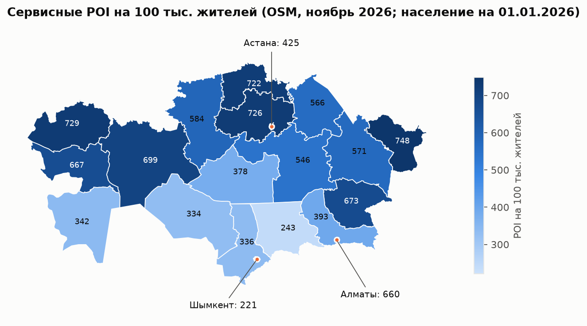
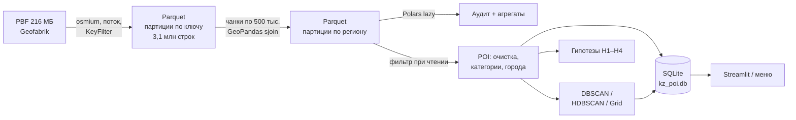
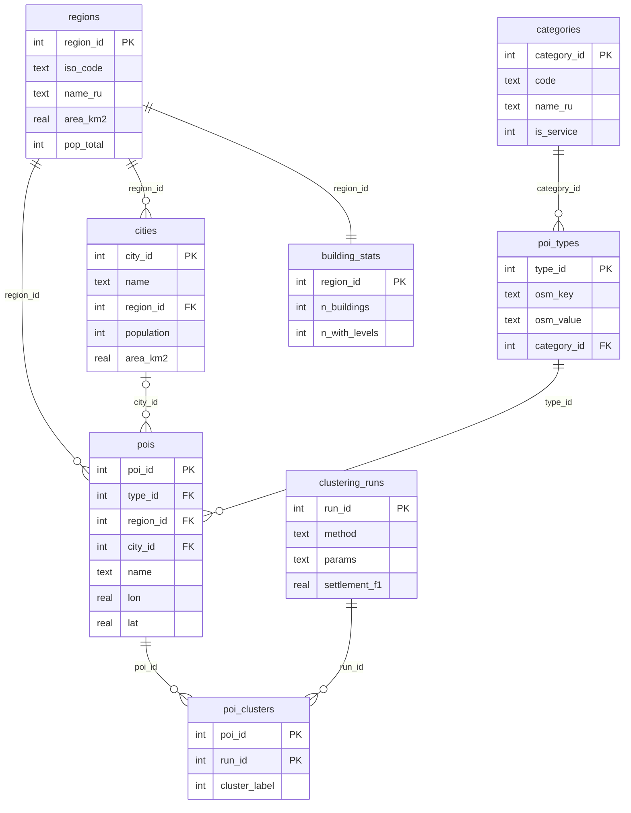

# OpenStreetMap Kazakhstan: Points of Interest Analytics

Итоговый проект по дисциплине **«Programming for Data Analysis and Database»**
(ОП Applied Artificial Intelligence, магистратура). Тема №47, Cluster 8 — *Large-Scale Data Processing*.

**Команда (группа AAI-2605M):** Zharken Utegenov · Yergaliev Aron · Temirgalin Dinmukhammed

**Цель:** проанализировать плотность и типы точек интереса (POI) по регионам и городам Казахстана
на основе полной выгрузки OpenStreetMap: POI на 100 тыс. жителей по регионам, Астана vs Алматы vs
другие города, пространственная кластеризация (DBSCAN).

## Ключевые результаты

| Что | Результат |
|---|---|
| Объём данных | PBF 216 МБ (34,5 млн узлов) → **3 109 206** объектов (POI + здания) за ~3 мин потоковым чтением, пик памяти ~1,2 ГБ |
| Оптимизация типов | **2 362 → 249 МБ** в памяти (−89,5 %); ошибка координат во float32 ≤ 0,4 м |
| Аудит и очистка | 138 032 → 136 261 POI, из них **102 774 сервисных**; найдена аномалия `amenity=public_building` (71 % — одна область) |
| Обеспеченность | в среднем **501** POI на 100 тыс. жителей; от 221 (Шымкент) до 748 (Восточно-Казахстанская обл.) |
| Мегаполисы | **Алматы 660 · Астана 425 · Шымкент 221**; 18 других городов ≥ 100 тыс. — 665 |
| Инструменты (3,1 млн строк) | **Polars lazy и DuckDB по Parquet ≈ 0,5–0,6 с** — в 6–7 раз быстрее baseline pandas + CSV (~3–3,7 с), между собой равны в пределах разброса; DuckDB экономнее по памяти (189 МБ), CSV по чанкам — минимум памяти (174 МБ); результаты всех 5 подходов совпали |
| Кластеризация | **DBSCAN (eps = 2 км) F1 = 0,904** против Grid baseline 0,798 и HDBSCAN 0,686 (eps подобран на 10 регионах, оценка на других 10) |
| Гипотезы | H2 (Астана ≠ Алматы по структуре) и H3 (в мегаполисах полнее часы работы) подтверждены; H1 и H4 — нет |

<p align="center">
  
</p>

Интерактивные версии: `outputs/figures/fig02_map_poi_per_100k.html` (Plotly), `fig11_cities_interactive.html`,
`fig05_hotspots_almaty.html` и `fig05_hotspots_astana.html` (Folium — «горячие точки» общепита и торговли).

**Отчёт:** `reports/report_osm_kz_poi.pdf` (и `.docx`) · **Презентация:** `reports/presentation_osm_kz_poi.pptx` (и `.pdf`).
Оба файла собираются из результатов скриптами `reports/build_report.py` и `reports/build_presentation.py`.

## Данные

| Источник | Что берём | Объём |
|---|---|---|
| [Geofabrik: kazakhstan-latest.osm.pbf](https://download.geofabrik.de/asia/kazakhstan.html) | все узлы и линии OSM с тегами `amenity, shop, healthcare, tourism, leisure, office, craft, historic, sport, emergency, building` | PBF 216 МБ: 34,5 млн узлов, 4,25 млн линий |
| [stat.gov.kz — численность населения по регионам на 01.01.2026](https://stat.gov.kz/ru/industries/social-statistics/demography/publications/475780/) | население 20 регионов (город/село) | `data/external/stat_gov_kz_population_by_region_2026-01-01.xlsx` |

PBF-файл в репозиторий не входит (216 МБ) — он скачивается автоматически (пункт 1 меню или `python main.py --all`).
Промежуточные данные (`data/interim/`, 3,1 млн строк) тоже воспроизводятся конвейером.
В репозитории лежат итоговые данные: `data/processed/pois_clean.parquet` (очищенные POI),
`data/processed/kz_poi.db` (SQLite), агрегаты по регионам и городам, границы регионов (GeoJSON).

## Быстрый старт

Требуется **Python 3.12** (на 3.13/3.14 у `osmium` может не оказаться готовых wheel-пакетов).

```bash
git clone https://github.com/Zhar04/programming_for_ai_final.git
cd programming_for_ai_final
python -m venv .venv
# Windows:
.venv\Scripts\activate
# Linux / macOS / Colab:
source .venv/bin/activate
pip install -r requirements.txt
```

| Команда | Что делает |
|---|---|
| `python main.py` | интерактивное консольное меню (шаги конвейера, поиск POI, ближайшие POI, SQL-запросы) |
| `python main.py --all` | весь конвейер от скачивания PBF до графиков (~10 мин, пик памяти ~1,5 ГБ) |
| `python main.py --step clustering` | один шаг конвейера (`download, extract, regions, optimize, audit, pois, database, benchmark, clustering, hypotheses, visualize`) |
| `streamlit run app.py` | дашборд с фильтрами: регион, категория, город, год правки |

Сразу после клонирования (без скачивания PBF) работают дашборд, пункты меню 12–16 и шаги
`database`, `clustering`, `hypotheses`, `visualize` — на данных из `data/processed/`.
Шаги `extract`, `regions`, `optimize`, `audit`, `pois`, `benchmark` обрабатывают исходный PBF:
он скачивается шагом 1 (`download`), промежуточные данные создаются в `data/interim/`.

**Google Colab:** `!git clone ...`, `%cd programming_for_ai_final`, `!pip install -r requirements.txt`,
`!python main.py --all`.

## Структура проекта

```
programming_for_ai_final/
├── main.py                 # точка входа: консольное меню и CLI (--all, --step)
├── app.py                  # Streamlit-дашборд с фильтрами
├── requirements.txt
├── src/
│   ├── config.py           # пути, константы, справочник регионов
│   ├── utils.py            # замер времени/памяти, JSON, чанковое чтение Parquet
│   ├── download.py         # шаг 1: скачивание PBF + проверка MD5
│   ├── extract.py          # шаг 2: потоковое чтение PBF (osmium) → партиционированный Parquet
│   ├── spatial.py          # шаг 3: регионы, население, города, sjoin по чанкам
│   ├── optimize.py         # шаг 4: оптимизация типов, память до/после
│   ├── quality.py          # шаг 5: аудит качества и правила очистки
│   ├── aggregates.py       # шаг 5: Polars lazy vs инкрементальные агрегаты по чанкам
│   ├── categories.py       # справочник 12 тематических категорий POI
│   ├── analysis.py         # шаг 6: POI на 100 тыс., города, структура категорий
│   ├── database.py         # шаг 7: SQLite — схема, загрузка, запросы, поиск
│   ├── benchmark.py        # шаг 8: Pandas vs Polars vs DuckDB (время, память, совпадение)
│   ├── clustering.py       # шаг 9: Grid baseline vs DBSCAN vs HDBSCAN
│   ├── hypotheses.py       # шаг 10: статистические гипотезы H1–H4
│   ├── visualize.py        # шаг 11: графики PNG + интерактивные HTML (Plotly, Folium)
│   ├── search.py           # ближайшие POI (BallTree, haversine)
│   └── pipeline.py         # оркестратор шагов
├── sql/
│   ├── schema.sql          # нормализованная схема (8 таблиц)
│   └── queries.sql         # 11 аналитических запросов (JOIN, HAVING, CTE, оконные функции)
├── data/
│   ├── external/           # население stat.gov.kz
│   └── processed/          # очищенные POI, SQLite, агрегаты, GeoJSON
├── outputs/
│   ├── figures/            # графики (PNG) и интерактивные карты (HTML)
│   ├── tables/             # CSV: результаты SQL, аудит, бенчмарк, кластеризация, гипотезы
│   └── metrics/            # JSON: время, память, метрики шагов
└── reports/                # отчёт (DOCX/PDF), презентация (PPTX/PDF) и скрипты их сборки
```

## Конвейер обработки



## База данных (ER-диаграмма)



PNG-версия: `outputs/figures/er_diagram.png`. Запросы — в `sql/queries.sql`, результаты — `outputs/tables/sql_*.csv`.

## Соответствие требованиям

**Технические требования (раздел II задания)**

| № | Требование | Где выполнено |
|---|---|---|
| 1 | ≥ 5 функций | 100+ функций в 17 модулях `src/` |
| 2 | list / dict | словари категорий (`categories.py`), реестр шагов `STEPS`, словарь накопленных сумм (`aggregates.py`), буфер-список (`extract.py`) |
| 3 | if / elif / else | `categories.categorize`, `utils.peak_memory_mb`, `download.verify_pbf`, `main.run_menu` |
| 4 | for / while | цикл по объектам PBF и батчам Parquet; `while` в BFS (`clustering.grid_baseline`) и в меню |
| 5 | файлы | Parquet, CSV, JSON, GeoJSON, SQLite; состояние программы — `outputs/run_state.json` |
| 6 | try / except | `utils.load_json`, `download.download_pbf`, `main.ask_int`, `database.run_all_queries`, `extract.extract_boundaries` |
| 7 | интерфейс | консольное меню `main.py` (16 пунктов) + дашборд `app.py` (5 фильтров, 5 вкладок) |
| 8 | модульность | 17 модулей + `main.py`, `app.py`; `os, sys, json, pathlib, datetime, re, hashlib, argparse, subprocess, sqlite3, tracemalloc` |
| 9 | ≥ 2 подхода + baseline | бенчмарк: baseline + 4 подхода (время, память, совпадение); кластеризация: Grid baseline vs DBSCAN vs HDBSCAN |
| 10 | БД и SQL | 8 таблиц, ER-диаграмма, 11 запросов (JOIN, HAVING, подзапросы, CTE, `ROW_NUMBER/RANK/NTILE/LAG/SUM OVER`) → pandas |
| 11 | ≥ 500 тыс. строк / 200 МБ | PBF 216 МБ, 3,1 млн строк; чанки, оптимизация типов, Parquet |

**Обязательные задачи Cluster 8 и фокус темы 47**

| Задача | Где выполнено |
|---|---|
| Данные больше памяти: чанки, партиционированный Parquet, `category`/downcast с замером памяти | `extract.py`, `spatial.assign_regions_chunked`, `optimize.py` |
| Сравнение ≥ 2 инструментов: время, пиковая память, совпадение | `benchmark.py` (pandas / Polars / DuckDB, CSV / Parquet) |
| Ленивые вычисления / инкрементальные агрегаты | `aggregates.py` (Polars lazy и groupby по чанкам, сверка результатов) |
| Аудит качества и обоснование очистки | `quality.py` → `outputs/tables/cleaning_rules.csv` |
| EDA, 4–5 визуализаций (≥ 1 интерактивная), ≥ 2 гипотезы | 11 PNG + 4 интерактивных HTML (Plotly, Folium); гипотезы H1–H4 (`hypotheses.py`) |
| Дашборд / меню; агрегаты в Parquet / SQLite | `app.py`, `main.py`; `data/processed/*.parquet`, `kz_poi.db` |
| Тема 47: чтение PBF и фильтр тегов · POI на 100 тыс. · Астана vs Алматы vs города · DBSCAN | `extract.py` · `analysis.region_stats` · `analysis.megacity_comparison` · `clustering.py` |

## Вклад участников

Работа распределена поровну (по ~⅓ на каждого); каждый участник может объяснить любой модуль.

| Участник | Зона ответственности | Модули |
|---|---|---|
| **Zharken Utegenov** | инженерия данных и производительность | `download.py`, `extract.py`, `optimize.py`, `aggregates.py`, `benchmark.py`, `pipeline.py`, `main.py`, README |
| **Yergaliev Aron** | пространственные данные, качество и БД | `spatial.py`, `quality.py`, `database.py`, `sql/schema.sql`, `sql/queries.sql`, ER-диаграмма, `search.py`, `app.py` |
| **Temirgalin Dinmukhammed** | аналитика, ML и представление результатов | `categories.py`, `analysis.py`, `clustering.py`, `hypotheses.py`, `visualize.py`, отчёт и презентация |

## Источники

1. OpenStreetMap contributors. Kazakhstan extract, Geofabrik GmbH, ноябрь 2026. Лицензия ODbL 1.0.
2. Бюро национальной статистики АСПиР РК. Численность населения по регионам на 1 января 2026 г.
3. Ester M., Kriegel H.-P., Sander J., Xu X. A density-based algorithm for discovering clusters in large spatial databases with noise (DBSCAN). KDD-96.
4. Campello R., Moulavi D., Sander J. Density-based clustering based on hierarchical density estimates (HDBSCAN). PAKDD 2013.
5. Документация: pyosmium, Polars, DuckDB, GeoPandas, scikit-learn, Streamlit.

Данные © участники OpenStreetMap, распространяются по лицензии [ODbL](https://opendatacommons.org/licenses/odbl/).
