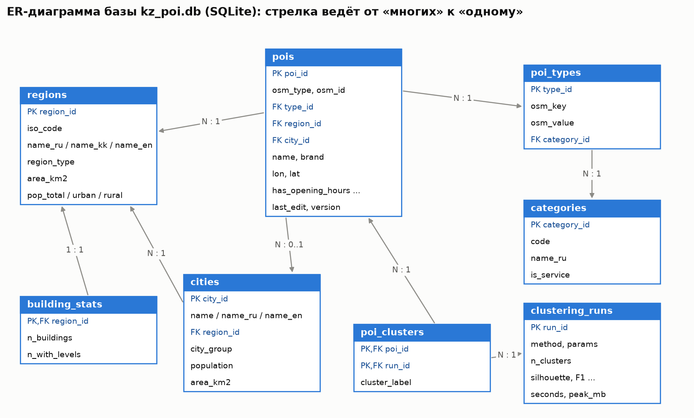
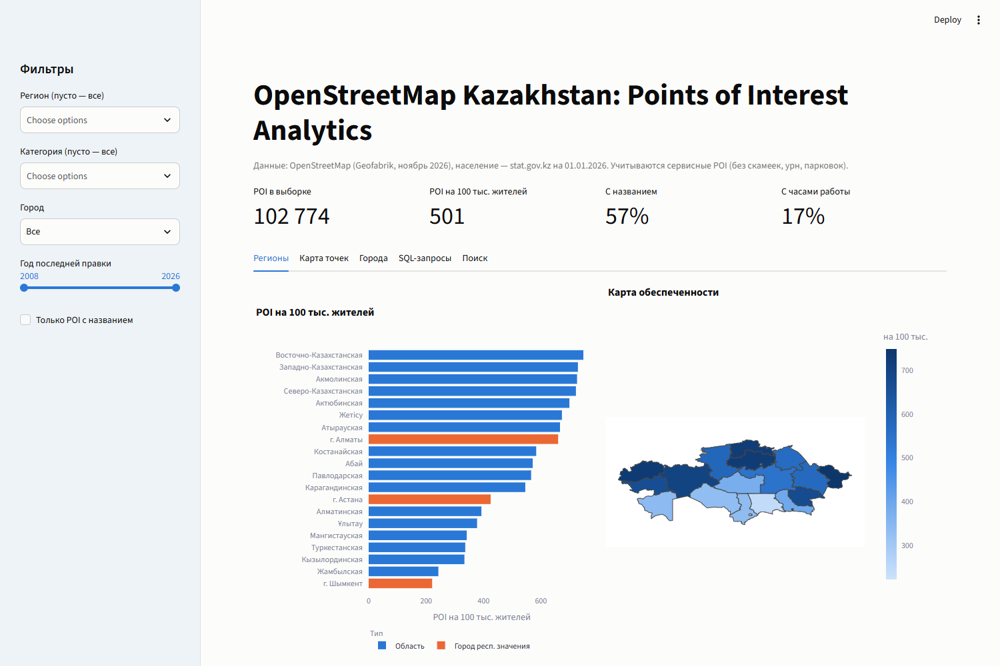
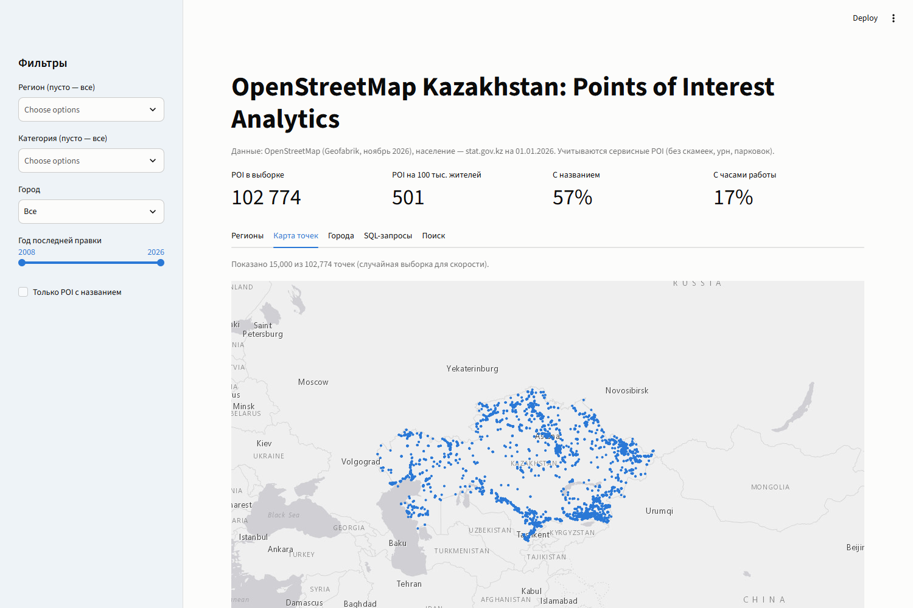
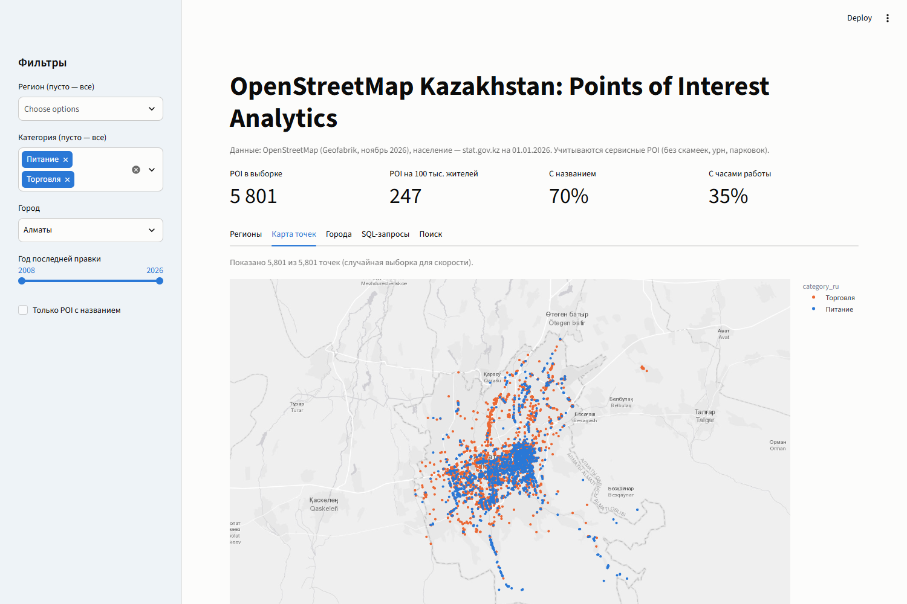
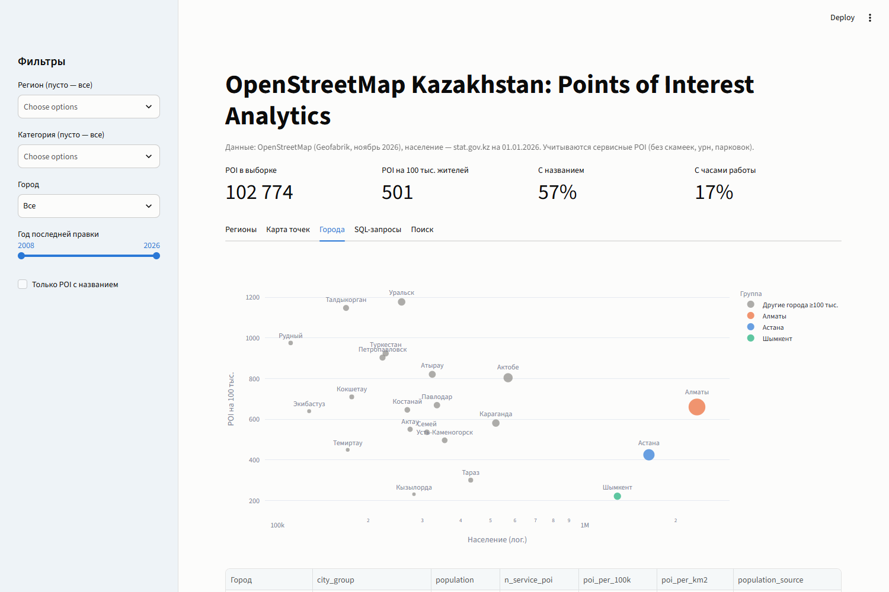
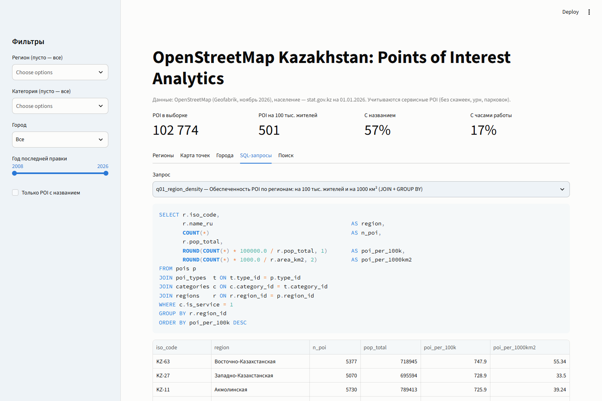
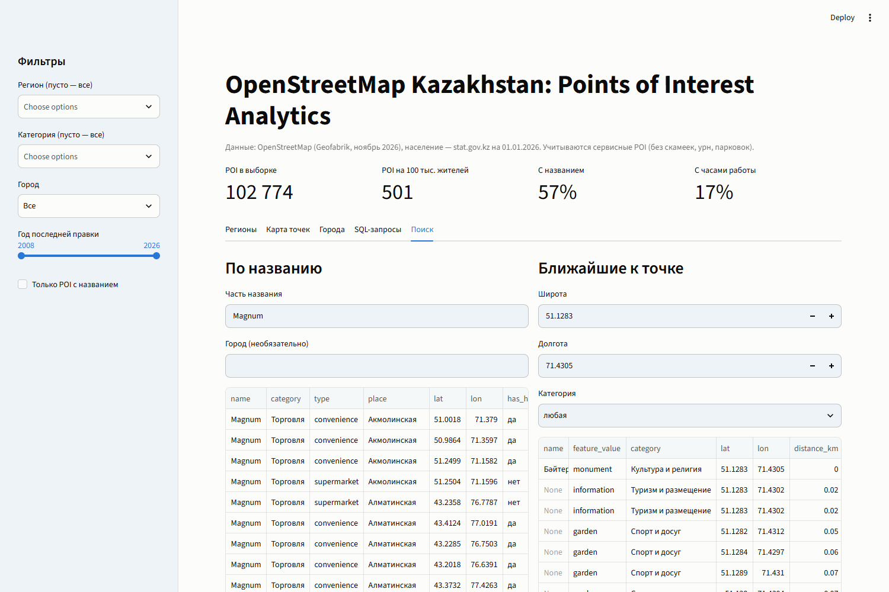

# Как устроен проект: подробный разбор

**OpenStreetMap Kazakhstan: Points of Interest Analytics** · тема 47, Cluster 8 (Large-Scale Data Processing)

Этот документ объясняет проект шаг за шагом: что делает каждый файл и функция, какие библиотеки
выбраны и почему, как работают дашборд и меню, какие проблемы встретились и как решены.
В конце — вероятные вопросы на защите с ответами.

**Содержание**

1. [Идея за одну минуту](#1-идея-за-одну-минуту)
2. [Словарь терминов](#2-словарь-терминов)
3. [Карта проекта: какой файл за что отвечает](#3-карта-проекта)
4. [Конвейер шаг за шагом](#4-конвейер-шаг-за-шагом)
5. [Библиотеки: что взяли, почему и как они работают](#5-библиотеки)
6. [База данных и SQL](#6-база-данных-и-sql)
7. [Дашборд Streamlit: что на экране и зачем](#7-дашборд-streamlit)
8. [Консольное меню](#8-консольное-меню)
9. [Проблемы, с которыми столкнулись](#9-проблемы-и-решения)
10. [Где в коде каждое требование задания](#10-где-в-коде-каждое-требование)
11. [Вероятные вопросы и ответы](#11-вероятные-вопросы-и-ответы)
12. [Шпаргалка: главные цифры](#12-главные-цифры)

---

## 1. Идея за одну минуту

Берём всю карту Казахстана из OpenStreetMap (один файл 216 МБ, 34,5 млн точек). Достаём из неё
«точки интереса» — магазины, кафе, школы, больницы, банки. Считаем, сколько таких объектов
приходится на 100 тыс. жителей в каждом из 20 регионов, сравниваем Астану, Алматы и другие
города и ищем скопления объектов алгоритмом DBSCAN.

Сложность в объёме: файл нельзя целиком загрузить в память. Поэтому тема относится к кластеру
«обработка больших данных», и главная инженерная часть — читать файл по частям, хранить в
Parquet, экономить память и сравнивать инструменты между собой.

```
PBF 216 МБ ──► Parquet (3,1 млн строк) ──► + регион ──► аудит и очистка ──► 102 774 сервисных POI
   osmium         чанки по 200 тыс.        GeoPandas       Polars              │
                                                                               ├─► показатели регионов и городов
                                                                               ├─► SQLite (8 таблиц, 11 запросов)
                                                                               ├─► DBSCAN / HDBSCAN / сетка
                                                                               ├─► гипотезы H1–H4
                                                                               └─► графики, дашборд, меню
```

---

## 2. Словарь терминов

| Термин | Что это |
|---|---|
| **OSM (OpenStreetMap)** | открытая карта мира, которую рисуют добровольцы; данные свободные (лицензия ODbL) |
| **PBF** | сжатый двоичный формат файла OSM. Внутри — узлы, линии и отношения |
| **node (узел)** | точка с координатами. Кафе, отмеченное точкой, — это node |
| **way (линия)** | упорядоченный список узлов. Замкнутая линия — контур здания или площадки |
| **relation (отношение)** | группа объектов, например граница области из многих линий |
| **тег** | пара «ключ = значение» у объекта: `amenity=cafe`, `shop=supermarket`, `name=Magnum` |
| **POI** | point of interest, точка интереса — объект с тегом `amenity`, `shop`, `tourism` и т.п. |
| **сервисный POI** | POI, который оказывает услугу. Скамейки, урны и парковки сюда не входят |
| **чанк (chunk)** | порция данных, которая обрабатывается за раз, чтобы не держать в памяти всё |
| **Parquet** | колоночный формат хранения таблиц: сжатый, с типами, читает только нужные столбцы |
| **партиционирование** | разбиение набора на папки по значению столбца: `feature_key=shop/`, `region_iso=KZ-71/` |
| **ленивые вычисления** | сначала строится план запроса, а считается всё только в момент `collect()` |
| **baseline** | простой базовый вариант, с которым сравнивают более сложные методы |
| **DBSCAN** | алгоритм кластеризации по плотности: кластер — место, где точки стоят густо |

---

## 3. Карта проекта

```
main.py            точка входа: консольное меню и запуск шагов (--all, --step)
app.py             дашборд Streamlit
requirements.txt   библиотеки с версиями
src/               вся логика, 17 модулей
sql/schema.sql     структура базы (8 таблиц)
sql/queries.sql    11 аналитических запросов
data/external/     население stat.gov.kz (xlsx)
data/raw/          исходный PBF — скачивается, в git не хранится
data/interim/      промежуточный Parquet на 3,1 млн строк — создаётся, в git не хранится
data/processed/    итог: очищенные POI, база SQLite, агрегаты, границы
outputs/figures/   графики PNG и интерактивные карты HTML
outputs/tables/    таблицы CSV: результаты SQL, аудит, бенчмарк, кластеризация
outputs/metrics/   JSON с замерами времени и памяти
reports/           отчёт, презентация и скрипты, которые их собирают
```

**Модули `src/` и кто их рассказывает**

| Модуль | Что делает | Ключевые функции | Кто отвечает |
|---|---|---|---|
| [config.py](../src/config.py) | все пути, константы, список тегов, справочник регионов | `ensure_dirs` | Жаркен |
| [utils.py](../src/utils.py) | замер времени и памяти, JSON, чтение Parquet частями | `peak_memory_mb`, `iter_parquet_chunks`, `load_json` | Жаркен |
| [download.py](../src/download.py) | скачивание PBF и проверка MD5 | `download_pbf`, `verify_pbf` | Жаркен |
| [extract.py](../src/extract.py) | потоковое чтение PBF, фильтр тегов, запись Parquet | `extract_features`, `classify_feature`, `way_center`, `flush_chunk` | Жаркен |
| [optimize.py](../src/optimize.py) | оптимизация типов, память до и после | `optimize_series`, `measure_memory_by_columns` | Жаркен |
| [aggregates.py](../src/aggregates.py) | агрегаты двумя способами: Polars lazy и по чанкам | `polars_lazy_summary`, `chunked_summary`, `compare_results` | Жаркен |
| [benchmark.py](../src/benchmark.py) | сравнение 5 способов обработки | `run_benchmark`, `run_single`, `APPROACHES` | Жаркен |
| [pipeline.py](../src/pipeline.py) | порядок шагов, запуск всего конвейера | `STEPS`, `run_all`, `step_*` | Жаркен |
| [spatial.py](../src/spatial.py) | регионы, население, города, привязка точек к полигонам | `load_regions`, `assign_regions_chunked`, `load_city_polygons` | Арон |
| [quality.py](../src/quality.py) | аудит качества и правила очистки | `audit_full_dataset`, `audit_and_clean_pois`, `find_semantic_duplicates` | Арон |
| [database.py](../src/database.py) | SQLite: схема, загрузка, запросы, поиск | `load_all`, `parse_queries`, `search_pois` | Арон |
| [search.py](../src/search.py) | ближайшие POI к точке | `nearest_pois` | Арон |
| [categories.py](../src/categories.py) | свод сотен тегов в 12 категорий | `categorize` | Динмухаммед |
| [analysis.py](../src/analysis.py) | показатели регионов и городов | `prepare_pois`, `region_stats`, `megacity_comparison` | Динмухаммед |
| [clustering.py](../src/clustering.py) | сетка, DBSCAN, HDBSCAN и их оценка | `grid_baseline`, `evaluate`, `run_clustering`, `split_regions` | Динмухаммед |
| [hypotheses.py](../src/hypotheses.py) | статистические гипотезы H1–H4 | `h1_urbanization` … `h4_mapping_completeness` | Динмухаммед |
| [visualize.py](../src/visualize.py) | все графики и карты | `plot_*` | Динмухаммед |

Распределение условное: по условию задания каждый участник должен уметь объяснить любой модуль.

---

## 4. Конвейер шаг за шагом

Все шаги перечислены в списке `STEPS` в [pipeline.py](../src/pipeline.py). Каждый шаг читает
вход с диска и пишет результат на диск. Поэтому шаги можно запускать по одному
(`python main.py --step clustering`) или все сразу (`python main.py --all`).

### Шаг 1. Скачивание — [download.py](../src/download.py)

- `download_pbf` качает файл **потоком, кусками по 1 МБ** (`requests.get(stream=True)`), а не
  целиком в память. Сначала пишет во временный файл `.part`, в конце переименовывает. Если связь
  оборвётся, недокачанный файл не будет принят за готовый.
- `verify_pbf` считает MD5 локального файла (тоже блоками по 4 МБ) и сравнивает с суммой, которую
  Geofabrik публикует рядом с файлом.
- Ошибки сети ловятся через `try / except requests.RequestException`.

### Шаг 2. Извлечение — [extract.py](../src/extract.py)

Это главный шаг для темы «большие данные».

1. `osmium.FileProcessor` читает PBF **объект за объектом**. Файл никогда не лежит в памяти целиком.
2. `KeyFilter(*config.EXTRACT_KEYS)` отбрасывает объекты без нужных тегов **внутри библиотеки на
   C++**. До Python доходит меньше 10 % объектов, поэтому чтение занимает минуты, а не часы.
3. `.with_locations()` ведёт кэш координат всех узлов. Он нужен, потому что линия (way) хранит
   только номера своих узлов, без координат. Кэш — основной потребитель памяти, около 1,2 ГБ.
4. `classify_feature` выбирает главный тег объекта по приоритету из `config.POI_KEYS`. Если у
   объекта есть и `amenity`, и `shop`, берётся тот, что раньше в списке.
5. `way_center` считает центр контура как среднее координат его узлов.
6. `build_row` собирает строку таблицы — словарь из 23 полей.
7. Строки копятся в списке-буфере. Каждые 200 000 строк `flush_chunk` записывает их в Parquet и
   очищает буфер. В памяти одновременно не больше одного чанка.

Parquet пишется с разбивкой на папки по ключу (`feature_key=amenity/`, `feature_key=building/`)
и с явной схемой типов `FEATURE_SCHEMA`. Схема нужна, чтобы в разных чанках у столбцов не
получились разные типы.

Отдельная функция `extract_boundaries` вторым проходом достаёт полигоны 20 регионов и городов и
точки населённых пунктов. Полигоны собирает сам osmium (`with_areas`), геометрия хранится в
формате WKB.

**Итог шага:** 3 109 206 строк, 16 чанков, Parquet 75 МБ вместо PBF 216 МБ.

### Шаг 3. Привязка к регионам — [spatial.py](../src/spatial.py)

- `load_population` читает таблицу stat.gov.kz и переводит тысячи человек в человек.
- `load_regions` соединяет полигоны OSM с населением по коду ISO (`KZ-71` — Астана) и считает
  площадь в равновеликой проекции. В градусах площадь считать нельзя: градус долготы на севере
  короче, чем на юге.
- `assign_regions_chunked` читает набор **частями по 500 тыс. строк** и для каждой части делает
  пространственное соединение `geopandas.sjoin(predicate="within")` — для каждой точки находит
  полигон, внутри которого она лежит. Результат пишется в новый Parquet с разбивкой по региону.
- Объекты за границей страны получают код `OUT`: выгрузка захватывает приграничье, таких 38 558.

### Шаг 4. Оптимизация типов — [optimize.py](../src/optimize.py)

`measure_memory_by_columns` проходит по столбцам по одному: читает столбец, приводит к «наивному»
типу (как после обычного `read_csv`), измеряет память, затем приводит к экономному типу и измеряет
снова.

| Было | Стало | Когда |
|---|---|---|
| `object` (строка) | `category` | уникальных значений меньше половины |
| `object` (строка) | `string[pyarrow]` | значения в основном разные (названия) |
| `int64` | `int8 / int16 / int32` | по диапазону значений (`downcast`) |
| `float64` | `float32` | координаты |

Почему `category` экономит память: вместо трёх миллионов строк `"building"` хранится словарь
из нескольких значений и массив коротких номеров.

**Итог:** 2 362 МБ → 249 МБ (−89,5 %). `float32_error_meters` показывает цену: ошибка координат
до 0,4 м, для анализа на уровне регионов это неважно.

### Шаг 5. Аудит и агрегаты — [quality.py](../src/quality.py), [aggregates.py](../src/aggregates.py)

**Аудит полного набора** (`audit_full_dataset`) идёт через Polars в ленивом режиме. Проверяются:
пропуски по столбцам, точные дубликаты, даты правок вне допустимого диапазона, этажность,
формат `start_date`.

**Агрегаты считаются двумя независимыми способами:**
- `polars_lazy_summary` — `scan_parquet → filter → group_by → collect`. Polars сам читает только
  5 нужных столбцов из 24.
- `chunked_summary` — читаем по 500 тыс. строк, pandas считает частичные суммы, они складываются
  в словарь `totals`.

`compare_results` проверяет, что оба способа дали одинаковый ответ. Это подтверждает
правильность обоих.

### Шаг 6. Очистка POI и показатели — [quality.py](../src/quality.py), [analysis.py](../src/analysis.py)

`load_pois` берёт из набора только POI внутри страны. Фильтр выполняется при чтении, поэтому в
pandas попадает 138 тыс. строк, а не 3,1 млн.

`audit_and_clean_pois` применяет правила и записывает каждое в таблицу
`outputs/tables/cleaning_rules.csv`:

| Правило | Строк | Что делаем | Почему |
|---|---|---|---|
| Значение тега `yes / no / unknown` | 949 | удаляем | тип объекта неизвестен |
| Смысловые дубликаты: тот же тип и название ближе 50 м | 822 | удаляем менее подробный | кафе отмечено и точкой, и контуром здания |
| `start_date` в непонятном формате | 30 | заменяем на пропуск | дату нельзя прочитать однозначно |
| Неверный формат часов работы, телефона, сайта | 106 / 2 569 / 23 | ставим флаг | объект существует, плох только атрибут |
| `amenity=public_building` | 3 991 | не считаем сервисом | см. раздел 9 |
| Выбросы по числу тегов | 4 173 | оставляем | подробное описание — не ошибка |

Дубликаты ищет `find_semantic_duplicates` через KD-дерево (`cKDTree.query_pairs`). Перебор всех
пар потребовал бы миллиардов сравнений, дерево находит близкие пары за секунду.

Затем `categorize` сводит теги в 12 категорий, `assign_cities` привязывает точки к городам, и
считаются показатели:
- `region_stats` — POI на 100 тыс. жителей и на 1000 км², доли заполненных атрибутов;
- `city_stats` и `megacity_comparison` — города;
- `category_matrix` — структура категорий по регионам.

### Шаг 7. База данных — [database.py](../src/database.py)

См. [раздел 6](#6-база-данных-и-sql).

### Шаг 8. Бенчмарк — [benchmark.py](../src/benchmark.py)

Одна и та же задача решается пятью способами:

| Способ | Идея |
|---|---|
| `pandas_csv` — **baseline** | прочитать весь CSV в память |
| `pandas_csv_chunks` | читать CSV кусками, суммы копить |
| `pandas_parquet` | прочитать из Parquet только нужные столбцы |
| `polars_lazy` | ленивый план + потоковое выполнение |
| `duckdb_sql` | SQL-запрос прямо по файлам Parquet |

Три решения, которые делают замер честным:
- **каждый запуск идёт в отдельном процессе** (`subprocess`). Иначе пиковая память одного
  способа осталась бы в замере следующего;
- **время — медиана трёх запусков**, чтобы случайная задержка не испортила результат;
- **результаты сверяются с эталоном** — быстрый, но неправильный способ не засчитывается.

### Шаг 9. Кластеризация — [clustering.py](../src/clustering.py)

Координаты переводятся в метры (`to_meters`), чтобы радиус задавать в метрах.

| Метод | Как работает |
|---|---|
| **Сетка (baseline)** — `grid_baseline` | страна делится на клетки 1×1 км; клетка с 10+ точками «плотная»; соседние плотные клетки склеиваются обходом в ширину |
| **DBSCAN** — `dbscan_labels` | точка становится ядром кластера, если в радиусе `eps` у неё 10+ соседей; ядра рядом сливаются в кластер; остальное — шум |
| **HDBSCAN** — `hdbscan_labels` | то же, но радиус подбирается сам для мест разной плотности |

**Как оценивали без «правильных ответов».** Взяли из OSM точки населённых пунктов
(`place=city/town/village`) как псевдо-разметку:
- precision — доля кластеров, чей центр ближе 3 км к населённому пункту;
- recall — доля городов, рядом с которыми есть кластер;
- F1 — их гармоническое среднее.

**Защита от утечки.** `split_regions` делит 20 регионов пополам. Радиус `eps` подбирается на
первой половине (`eps_sensitivity`), а три метода сравниваются на второй. Параметр не видел
данных, на которых его оценивают.

`cluster_error_analysis` разбирает кластеры, которые не совпали с населёнными пунктами.
`city_hotspots` запускает DBSCAN с малым радиусом (100 м) внутри Алматы и Астаны и находит
торговые улицы и рынки.

### Шаг 10. Гипотезы — [hypotheses.py](../src/hypotheses.py)

| | Гипотеза | Тест | Итог |
|---|---|---|---|
| H1 | больше горожан в регионе → больше POI на душу | корреляция Спирмена | не подтвердилась (ρ = 0,11; p = 0,32) |
| H2 | структура категорий в Астане и Алматы разная | хи-квадрат + V Крамера | подтвердилась, но связь слабая (V = 0,086) |
| H3 | в мегаполисах чаще указаны часы работы | z-тест для двух долей | подтвердилась (26,6 % против 14,1 %) |
| H4 | больше зданий в OSM → больше POI | корреляция Спирмена | не подтвердилась (ρ = 0,09; p = 0,36) |

### Шаг 11. Графики — [visualize.py](../src/visualize.py)

11 картинок PNG для отчёта и 4 интерактивных HTML: карта регионов и диаграмма городов на Plotly,
две карты «горячих точек» на Folium.

---

## 5. Библиотеки

| Библиотека | Для чего | Почему именно она | Как работает |
|---|---|---|---|
| **osmium (pyosmium)** | чтение PBF | единственная, что читает файл потоком; pyrosm грузит всё в память | обёртка над C++-библиотекой libosmium: отдаёт объекты по одному, фильтры работают до Python |
| **pyarrow** | запись и чтение Parquet | стандарт для Parquet в Python, умеет разбивку на папки | колоночный формат Arrow: столбец лежит в памяти сплошным блоком |
| **pandas** | работа с POI (136 тыс. строк) | совместим с GeoPandas, scikit-learn, SQLite | таблица в памяти, операции над столбцами целиком |
| **Polars** | аудит и агрегаты по 3,1 млн строк | ленивый режим и многопоточность | строит план запроса, оптимизирует его и выполняет на Rust во всех ядрах |
| **DuckDB** | участник бенчмарка | SQL прямо по файлам, без загрузки в базу | встроенная аналитическая база, обрабатывает данные колонками |
| **GeoPandas + Shapely** | полигоны и привязка точек | самый простой способ сделать «точка в полигоне» | pandas с геометрическим столбцом; `sjoin` использует пространственный индекс |
| **pyproj** | перевод градусов в метры | точные картографические проекции | обёртка над библиотекой PROJ |
| **sqlite3** | база данных | входит в Python, не нужен сервер, база — один файл | — |
| **scikit-learn** | DBSCAN, HDBSCAN, метрики, поиск соседей | стандартная библиотека машинного обучения | DBSCAN ищет соседей через KD-дерево |
| **SciPy** | KD-дерево, статистические тесты | быстрый поиск близких точек | `cKDTree` делит пространство пополам рекурсивно |
| **statsmodels** | z-тест для долей | готовая реализация | — |
| **matplotlib + seaborn** | статические графики | полный контроль над видом, PNG для отчёта | — |
| **Plotly** | интерактивные графики | требование задания; наведение показывает цифры | рисует в браузере на JavaScript |
| **Folium** | карты с «горячими точками» | рекомендована в теме; карта на Leaflet одним файлом HTML | генерирует HTML с библиотекой Leaflet |
| **Streamlit** | дашборд | дашборд на чистом Python, без HTML и JavaScript | при любом действии пользователя скрипт выполняется заново сверху вниз |
| **psutil** | замер памяти процесса | работает на Windows, Linux и macOS | читает счётчики операционной системы |
| **requests** | скачивание файла | потоковая загрузка одной строкой | — |

**Почему pandas и Polars вместе.** Polars быстрее на больших агрегатах, а pandas нужен там, где
данные уходят в GeoPandas и scikit-learn. Берём каждый инструмент там, где он сильнее.

**Почему не Dask.** Данные после извлечения — 3,1 млн строк. Это помещается в одну машину, и
Polars с DuckDB обрабатывают их за полсекунды. Dask оправдан на кластере или на сотнях миллионов
строк.

**Почему SQLite, а не PostgreSQL.** Не нужен отдельный сервер: проект запускается у преподавателя
одной командой, база лежит в репозитории одним файлом.

---

## 6. База данных и SQL



**Почему схема нормализованная.** Название категории «Питание» хранится один раз в таблице
`categories`, а не в 9 тысячах строк. Таблица фактов `pois` содержит только номера (внешние
ключи) на справочники.

| Таблица | Что хранит | Строк |
|---|---|---|
| `regions` | 20 регионов: код, названия, площадь, население | 20 |
| `categories` | 12 категорий и флаг «сервис» | 12 |
| `poi_types` | пары тегов OSM и их категория | 673 |
| `cities` | города для сравнения | 21 |
| `pois` | очищенные точки интереса — таблица фактов | 136 261 |
| `building_stats` | число зданий по регионам (сами 3 млн зданий в базу не грузим) | 20 |
| `clustering_runs` | запуски кластеризации и их метрики | 3 |
| `poi_clusters` | метка кластера для каждой точки в каждом запуске | 308 322 |

`poi_clusters` реализует связь «многие-ко-многим»: одна точка участвует в трёх запусках, в одном
запуске участвуют тысячи точек.

**Порядок загрузки** в `load_all`: сначала справочники, потом факты. Иначе проверка внешних
ключей (`PRAGMA foreign_keys = ON`) не пропустит строку со ссылкой на несуществующий регион.

**Запросы** лежат в [sql/queries.sql](../sql/queries.sql). Перед каждым стоит строка
`-- name: ...`, по ней `parse_queries` разбирает файл на отдельные запросы.

| Запрос | Что считает | Конструкции SQL |
|---|---|---|
| q01 | POI на 100 тыс. и на 1000 км² по регионам | 3 × `JOIN`, `GROUP BY` |
| q02 | три главные категории в каждом регионе | `WITH`, `ROW_NUMBER() OVER (PARTITION BY)` |
| q03 | регионы, где доля общепита выше средней | `HAVING` + подзапрос |
| q04 | мегаполисы против других городов | два `WITH`, оконная `SUM` |
| q05 | рейтинг регионов | `RANK`, `NTILE(4)`, `LAG`, `FIRST_VALUE` |
| q06 | накопленная доля POI | `SUM() OVER (ORDER BY … ROWS BETWEEN …)` |
| q07 | полнота атрибутов | `AVG` флагов, `HAVING COUNT(*) > 2000` |
| q08 | сетевые бренды в 5+ регионах | `COUNT(DISTINCT)`, `HAVING`, `WITH` |
| q09 | правки по годам | `strftime`, `LAG`, накопленная сумма |
| q10 | города лучше своей области | коррелированный подзапрос |
| q11 | крупнейшие кластеры DBSCAN | пять `WITH`, `JOIN`, окно |

Результаты загружаются в pandas через `pd.read_sql_query` и сохраняются в `outputs/tables/sql_*.csv`.

**Поиск по названию** (`search_pois`) использует параметры `?` вместо подстановки текста в
запрос. Это защита от SQL-инъекций: введённый пользователем текст не может стать частью команды.

---

## 7. Дашборд Streamlit

Запуск: `streamlit run app.py`, затем в браузере открыть `http://localhost:8501`.

**Как он устроен.** Весь дашборд — один файл [app.py](../app.py). Streamlit при любом действии
пользователя выполняет скрипт заново сверху вниз. Чтобы не перечитывать данные каждый раз,
функция `load_data` помечена `@st.cache_data`: данные читаются один раз и берутся из кэша.

Дашборд работает на готовых файлах из `data/processed/`, поэтому открывается сразу после
клонирования репозитория, без пересчёта.

### Боковая панель: фильтры

| Элемент | Что делает |
|---|---|
| **Регион** | выбор одного или нескольких регионов; пусто — все 20 |
| **Категория** | выбор категорий; пусто — все 11 сервисных |
| **Город** | один из 21 города или «Все» |
| **Год последней правки** | ползунок с двумя границами: показывает, какие данные свежие |
| **Только POI с названием** | убирает безымянные объекты |

Все фильтры собираются в одну маску `mask`, и каждая вкладка строится по одному и тому же
срезу `view`. Четыре числа сверху пересчитываются при любом изменении фильтра.

### Вкладка «Регионы»



- **Четыре числа сверху** — сколько POI в выборке, сколько на 100 тыс. жителей, доля с названием
  и доля с часами работы.
- **Столбцы слева** — рейтинг регионов. Синие — области, оранжевые — города республиканского
  значения.
- **Карта справа** — те же цифры на карте: чем темнее регион, тем больше POI на душу.
- **Таблица под графиками** — точные значения.

### Вкладка «Карта точек»



Каждая точка — один объект. При наведении видно название и тип. Показывается случайная выборка
до 15 000 точек, чтобы браузер не тормозил. Кнопка «Скачать выборку (CSV)» сохраняет
отфильтрованные данные.

Если выбрать город и до трёх категорий, точки раскрашиваются по категориям, а карта сама
приближается к городу:



Больше трёх цветов не используем: на карте они перестают различаться.

### Вкладка «Города»



По горизонтали — население города (логарифмическая шкала), по вертикали — POI на 100 тыс.
жителей, размер кружка — число POI. Видно, что Шымкент лежит внизу, хотя это третий город страны.

### Вкладка «SQL-запросы»



Выбираете любой из 11 запросов и видите его текст и результат. Запрос выполняется в базе в
момент выбора. Удобно на защите: можно показать код запроса и сразу ответ.

### Вкладка «Поиск»



- **Слева — поиск по названию.** Работает через SQL с параметрами. Регистр не важен, в том
  числе для кириллицы. Поиск идёт сразу по трём полям: `name`, `name:ru` и `name:kk`.
- **Справа — ближайшие объекты к точке.** Вводите широту, долготу и категорию. Расстояние
  считается по поверхности Земли (формула гаверсинуса), поиск идёт через дерево `BallTree`.
  На скриншоте координаты Байтерека — и первый результат действительно монумент «Байтерек».

---

## 8. Консольное меню

Запуск: `python main.py`.

```
================================================================
  OpenStreetMap Kazakhstan: Points of Interest Analytics
================================================================
   1 – Скачать и проверить PBF (Geofabrik)
   2 – Извлечь POI и здания из PBF → Parquet
   3 – Привязать объекты к регионам (чанки)
   4 – Оптимизация типов и замер памяти
   5 – Аудит качества + агрегаты (Polars lazy / чанки)
   6 – Очистка POI, показатели регионов и городов
   7 – Загрузка в SQLite и SQL-запросы
   8 – Бенчмарк Pandas / Polars / DuckDB
   9 – Кластеризация DBSCAN vs baseline vs HDBSCAN
  10 – Проверка гипотез H1–H4
  11 – Построить графики
  12 – Поиск POI по названию (SQL)
  13 – Ближайшие POI к точке (широта/долгота)
  14 – Показатели региона
  15 – Выполнить SQL-запрос из sql/queries.sql
  16 – Состояние проекта (какие шаги выполнены)
   A – Запустить весь конвейер
   0 – Выход
```

| Пункты | Что делают | Функция в [main.py](../main.py) |
|---|---|---|
| 1–11 | шаги конвейера из списка `STEPS` | `run_menu` |
| 12 | поиск по названию с фильтром по городу | `menu_search` |
| 13 | 10 ближайших объектов к координатам | `menu_nearest` |
| 14 | карточка региона по коду или части названия | `menu_region` |
| 15 | любой из 11 SQL-запросов | `menu_sql` |
| 16 | какие шаги выполнены и когда | `menu_state` |

**Как устроено меню:**
- `run_menu` — цикл `while True`, выход по `0` через `break`;
- пункты 1–11 не прописаны вручную: меню берёт их из списка `STEPS`. Добавили шаг в конвейер —
  он сам появился в меню;
- `ask_int` и `ask_float` спрашивают число в цикле, пока не введут правильное. Неверный ввод
  ловится через `try / except ValueError`;
- если шаг запущен раньше времени и нет нужного файла, ловится `FileNotFoundError`, и программа
  подсказывает выполнить предыдущие шаги, а не падает;
- состояние хранится в `outputs/run_state.json` — программа помнит, что уже сделано.

**Что показать на защите за 30 секунд:** `14` → `KZ-71` (карточка Астаны), затем `13` →
`51.1283` → `71.4305` → `1` (кафе у Байтерека), затем ввести `abc` (обработка ошибки).

---

## 9. Проблемы и решения

| № | Проблема | Как нашли | Решение |
|---|---|---|---|
| 1 | **Файл не помещается в память.** 34,5 млн узлов в таблице заняли бы больше 5 ГБ | оценка объёма | потоковое чтение osmium, фильтр на стороне C++, запись чанками по 200 тыс. |
| 2 | **Аномалия `amenity=public_building`.** Алматинская область выходила лидером по «госуслугам» | на тепловой карте категорий: 33 % против 3–6 % у большинства регионов | 71 % таких объектов — безымянные здания одной области, размеченные массово в 2018–2019 гг. Тег устаревший, перестали считать его сервисом |
| 3 | **DuckDB работал 6,8 с вместо 0,5 с** | бенчмарк показал его медленнее baseline | Parquet был раздроблен на 7 632 мелких блока. Стали склеивать данные перед записью (`combine_chunks`) |
| 4 | **Чтение Parquet отдавало 936 мелких порций** вместо 7 | счётчик батчей в логе | написали `iter_parquet_chunks`: копит порции до нужного размера |
| 5 | **Правило IQR для этажности не работает** | Q1 = Q3 = 1: большинство зданий одноэтажные, размах равен нулю | выбросами считаем значения выше 99-го перцентиля |
| 6 | **Дубликаты объектов.** Одно кафе отмечено и точкой, и контуром здания | аудит | ищем пары «тот же тип и название ближе 50 м» через KD-дерево, оставляем более подробный |
| 7 | **Поиск по кириллице учитывал регистр** | «магнум» не находил «Магнум» | встроенная функция `LOWER` в SQLite понимает только латиницу. Зарегистрировали свою функцию `PYLOWER` на Python |
| 8 | **Интерактивная карта Plotly заливала всё одним цветом** | просмотр HTML | у полигонов был обратный порядок обхода вершин, и регион понимался как «весь мир минус регион». Исправили ориентацию (`_orient_clockwise`) |
| 9 | **Вместо карты надпись «403 Access blocked»** | открыли HTML с диска | серверы OSM блокируют запросы без адреса страницы-источника, а у локального файла его нет. CARTO требует платный ключ. Перешли на подложку Esri |
| 10 | **Карта в дашборде открывалась на Африке** | проверка вкладки | карта создаётся в скрытой вкладке, и автоподбор центра ошибается. Центр и масштаб задаём по данным |
| 11 | **Кластер из 56 «заправок» в чистом поле** | анализ ошибок кластеризации | резервуары нефтебазы под Алматы размечены как АЗС одной правкой. Описали как ограничение данных |
| 12 | **Центр Алматы сливался в один «хотспот» на 1 130 точек** | просмотр карты | уменьшили радиус со 150 до 100 м |
| 13 | **Polars и DuckDB менялись местами по скорости** | повторные прогоны | разница в десятые доли секунды меньше разброса замеров. Честно пишем «равны» |
| 14 | **Библиотека osmium не ставилась на Python 3.14** | установка | используем Python 3.12, это записано в README |
| 15 | **Дата снимка была зашита в код** | финальная проверка | при более свежем файле новые правки считались бы «датами из будущего». Граница теперь — момент запуска |

**Главное ограничение данных.** OSM показывает активность картографов, а не реальное число
объектов. В Казахстане бизнес чаще отмечается в 2ГИС. Низкий показатель Шымкента — это скорее
«город плохо нанесён на карту», чем «в городе мало магазинов». Это подтверждают и гипотезы H1 и
H4, которые не подтвердились.

---

## 10. Где в коде каждое требование

**Технические требования**

| № | Требование | Где смотреть |
|---|---|---|
| 1 | 5+ функций | 130 функций; примеры: `extract.classify_feature`, `quality.find_semantic_duplicates`, `clustering.grid_baseline` |
| 2 | списки и словари | буфер `buffer` в `extract_features`; словарь `totals` в `chunked_summary`; `AMENITY_GROUPS` в `categories.py`; список `STEPS` |
| 3 | `if / elif / else` | `categories.categorize`; `utils.peak_memory_mb` (ветки по операционной системе); `download.verify_pbf` |
| 4 | циклы | `for obj in processor` в `extract.py`; `while queue` в `grid_baseline`; `while True` в `main.run_menu` |
| 5 | файлы | `utils.save_json / load_json`; Parquet в `flush_chunk`; CSV в `quality.py`; `run_state.json` |
| 6 | `try / except` | `utils.load_json`; `download.download_pbf`; `main.ask_int`; `database.run_all_queries` |
| 7 | интерфейс | `main.py` (меню) и `app.py` (дашборд) |
| 8 | модульность | 17 модулей в `src/`; `os, sys, json, pathlib, datetime, re, hashlib, argparse, subprocess, sqlite3` |
| 9 | 2+ подхода и baseline | `benchmark.py` (5 способов) и `clustering.py` (3 метода) |
| 10 | база и SQL | `sql/schema.sql`, `sql/queries.sql`, `database.py`, ER-диаграмма |
| 11 | объём данных | PBF 216 МБ, 3,1 млн строк; чанки, типы, Parquet |

**Обязательные задачи кластера 8**

| Задача | Где смотреть |
|---|---|
| данные больше памяти, чанки, Parquet с разбивкой, типы и память | `extract.py`, `spatial.assign_regions_chunked`, `optimize.py` |
| сравнение 2+ инструментов: время, память, совпадение | `benchmark.py` → `outputs/tables/benchmark_tools.csv` |
| ленивые вычисления или агрегаты по частям | `aggregates.py` — оба варианта и сверка |
| аудит качества и обоснование очистки | `quality.py` → `outputs/tables/cleaning_rules.csv` |
| 4–5 графиков, один интерактивный, 2+ гипотезы | `visualize.py`, `hypotheses.py` |
| дашборд или меню, агрегаты в Parquet и SQLite | `app.py`, `main.py`, `data/processed/` |

---

## 11. Вероятные вопросы и ответы

### Данные и обработка

**Почему нельзя просто прочитать файл целиком?**
В нём 34,5 млн узлов. В виде таблицы с координатами и тегами это больше 5 ГБ памяти. Мы читаем
поток объектов и сразу отбрасываем ненужные.

**Что такое чанк и где он в коде?**
Порция строк. В `extract_features` строки копятся в списке `buffer`; когда их набирается
200 000, `flush_chunk` пишет их на диск, и список очищается.

**Откуда тогда 1,2 ГБ памяти, если читаем по частям?**
Это кэш координат узлов (`with_locations`). Контур здания хранит только номера узлов, и чтобы
посчитать его центр, нужны координаты всех узлов. Кэш можно вынести на диск, но это медленнее.

**Чем Parquet лучше CSV?**
Он колоночный: чтобы посчитать агрегат по 5 столбцам, читаются только они, а не все 24. Он
хранит типы и сжат. У нас Parquet в 3,6 раза меньше CSV, а агрегат по нему считается в 5–7 раз быстрее.

**Что значит «партиционированный»?**
Данные разложены по папкам: `region_iso=KZ-71/`. Если нужна только Астана, остальные папки даже
не открываются.

**Что такое ленивые вычисления?**
`pl.scan_parquet(...)` ничего не читает, а строит план. Polars оптимизирует план — например,
решает читать только нужные столбцы — и выполняет всё в момент `.collect()`.

**Как мерили память?**
Пиковую память процесса берём у операционной системы через `psutil`
(`utils.peak_memory_mb`). Каждый способ запускается в отдельном процессе, чтобы замеры не
смешивались.

**Что является baseline в бенчмарке?**
`pandas.read_csv` всего файла — так делают по умолчанию. С ним сравниваются четыре других
способа.

### Качество данных

**Как нашли дубликаты?**
Точные — по паре (`osm_type`, `osm_id`), их нет. Смысловые — KD-деревом: пары точек ближе 50 м
с одинаковым типом и названием. Из пары удаляем объект с меньшим числом тегов.

**Почему часть «плохих» данных не удалили, а пометили?**
Если у кафе неверно записан телефон, кафе всё равно существует. Удалив его, мы занизили бы число
объектов. Поэтому ставим флаг `phone_valid = False`.

**Что такое IQR и почему он не сработал?**
Межквартильный размах: выбросом считают значение дальше 1,5 размаха от квартилей. У этажности
оба квартиля равны 1, размах нулевой, и выбросом стало бы всё, что не один этаж. Взяли
99-й перцентиль.

### База данных

**Почему схема нормализованная?**
Каждый факт хранится один раз. Переименовали категорию — меняем одну строку справочника, а не
тысячи строк.

**Что такое оконная функция?**
Функция, которая считает значение по группе строк, но не сворачивает их. Пример — q02:
`ROW_NUMBER() OVER (PARTITION BY region ORDER BY n DESC)` нумерует категории внутри каждого
региона, и мы берём первые три.

**Что такое CTE?**
Именованный подзапрос в начале: `WITH counts AS (...) SELECT ... FROM counts`. Делает длинный
запрос читаемым.

**Чем HAVING отличается от WHERE?**
`WHERE` отбирает строки до группировки, `HAVING` — группы после неё. В q07
`HAVING COUNT(*) > 2000` оставляет только регионы, где больше 2000 объектов.

### Кластеризация и статистика

**Как работает DBSCAN?**
Два параметра: радиус `eps` и минимум соседей `min_samples`. Точка с 10+ соседями в радиусе —
ядро. Ядра, достижимые друг от друга, образуют кластер. Точки без ядра рядом — шум. Число
кластеров задавать не нужно, форма кластера любая.

**Как выбрали eps = 2000 м?**
Перебрали 9 значений от 150 до 5000 м и взяли то, где F1 максимален. Дополнительно проверили
графиком k-distance: перелом кривой в том же диапазоне.

**Почему DBSCAN, а не KMeans?**
KMeans требует заранее знать число кластеров и ищет круглые кластеры одного размера. Города
разного размера и формы, а половина точек в степи — шум. DBSCAN справляется со всем этим.

**Почему HDBSCAN оказался хуже?**
Он лучше по силуэту, но дробит город на десятки кварталов. Нам нужно было «один населённый
пункт — один кластер», и по этой задаче он проиграл. К тому же он в десятки раз медленнее.

**Что такое утечка данных и как её избежали?**
Это когда параметр подбирают на тех же данных, на которых потом оценивают. Мы подбирали `eps`
на 10 регионах, а сравнивали методы на других 10.

**Почему H1 и H4 не подтвердились и плохо ли это?**
Не плохо, это результат. Он показывает, что число POI в OSM зависит от активности местных
картографов, а не от урбанизации или подробности карты зданий.

**Что такое p-value?**
Вероятность получить такой же или более сильный результат случайно, если связи на самом деле
нет. Если p меньше 0,05 — считаем связь значимой.

### Общие

**Кто что делал?**
Жаркен — загрузка, извлечение, память, бенчмарк, конвейер, меню. Арон — регионы, аудит
качества, база и SQL, поиск, дашборд. Динмухаммед — категории, показатели, кластеризация,
гипотезы, графики, отчёт.

**Как запустить проект?**
`pip install -r requirements.txt`, затем `python main.py` (меню), `python main.py --all` (весь
расчёт, 7–10 минут) или `streamlit run app.py` (дашборд).

**Что бы улучшили?**
Сравнили бы с данными 2ГИС, чтобы оценить полноту OSM. Посчитали бы не число объектов, а время
пути до ближайшего по дорожной сети. Настроили бы ежемесячное обновление.

---

## 12. Главные цифры

| Показатель | Значение |
|---|---|
| Исходный файл | 216 МБ, 34,5 млн узлов, 4,25 млн линий |
| Извлечено объектов | 3 109 206 (из них ~2,93 млн зданий) |
| Чанк записи / чтения | 200 000 / 500 000 строк |
| Пиковая память при извлечении | ~1,2 ГБ |
| Память таблицы до / после оптимизации | 2 362 МБ / 249 МБ (−89,5 %) |
| POI до / после очистки | 138 032 / 136 261 |
| Сервисных POI | 102 774 |
| В среднем по стране | 501 на 100 тыс. жителей |
| Максимум / минимум | ВКО — 748 / Шымкент — 221 |
| Алматы / Астана / Шымкент | 660 / 425 / 221 |
| Другие 18 городов от 100 тыс. | 665 |
| Бенчмарк | pandas + CSV ~3 с; Polars и DuckDB ~0,5 с (в 6–7 раз быстрее) |
| Кластеризация, F1 | DBSCAN 0,904 · сетка 0,798 · HDBSCAN 0,686 |
| DBSCAN | eps = 2000 м, min_samples = 10, 613 кластеров, шум 7,5 % |
| База | 8 таблиц, 11 запросов |
| Код | 17 модулей, 130 функций |
| Население (01.01.2026) | 20 495 975 |
